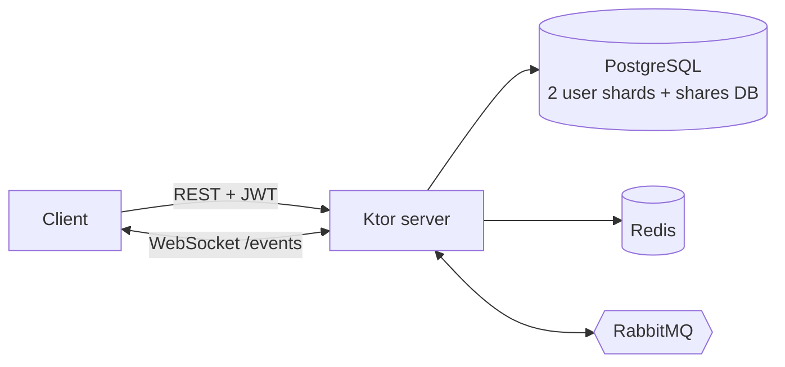

# Begoml Shares Backend

Backend for a stock trading app, written in Kotlin with Ktor. Users register, keep a wallet they can deposit to and withdraw from,
browse a share catalogue and receive live price updates over a WebSocket.

It is a learning and reference project. Alongside a regular REST API, it shows a few patterns you usually meet in larger systems:

- **Sharding** of user data across PostgreSQL databases through virtual shards
- **Atomic money operations**: a balance check and a debit in one SQL statement, safe under concurrent requests
- **Event broadcast** to every server instance through a RabbitMQ fanout exchange, pushed to clients over WebSockets
- **Redis** as a price store and a fixed-window rate limiter
- **Layered architecture** with a framework-free business logic layer

How it all fits together, with diagrams: **[docs/architecture.md](docs/architecture.md)**.



## Tech stack

Kotlin 1.9 · Ktor 2.3 (CIO) · Koin · Exposed · PostgreSQL · Redis (Jedis) · RabbitMQ · Quartz · kotlinx.serialization · bcrypt · JUnit 5 + H2

## API

All routes except `/login`, `/registration` and `/swagger` need `Authorization: Bearer <token>`.

| Method | Path | Description |
|---|---|---|
| POST | `/registration` | Create a user, returns a JWT |
| POST | `/login` | Log in, returns a JWT |
| GET | `/user` | Current user and profile |
| POST | `/user/update` | Update profile name and/or age |
| GET | `/wallet` | Current user's wallet |
| POST | `/wallet/create` | Create the wallet |
| POST | `/wallet/update/name` | Rename the wallet |
| POST | `/wallet/deposit` | Deposit (rate limited, needs a confirmation code) |
| POST | `/wallet/withdraw` | Withdraw (rate limited, needs a confirmation code) |
| GET | `/shares` | Share catalogue with current prices |
| GET | `/shareInfo?symbol=AAPL` | One share with description and price |
| GET | `/prices` | Current prices of all shares |
| WS | `/events` | Live price updates |
| GET | `/swagger` | Swagger UI |

## Running locally

### 1. Start the services

```bash
brew install postgresql@16 redis rabbitmq
brew services start postgresql@16
brew services start redis
brew services start rabbitmq
```

Create the three databases (names match the defaults below):

```bash
createdb begoml_share
createdb begoml_shares_second
createdb begoml_shares_shares
```

Tables are created on startup.

### 2. Configure

The server reads its settings from environment variables. Secrets have no defaults, so it does not start without them.

| Variable | Required | Default |
|---|---|---|
| `DATABASE_PASSWORD` | yes | — |
| `JWT_SECRET` | yes | — |
| `DATABASE_USER` | no | `postgres` |
| `DATABASE_URL_SHARD_1` | no | `jdbc:postgresql://localhost:5432/begoml_share` |
| `DATABASE_URL_SHARD_2` | no | `jdbc:postgresql://localhost:5432/begoml_shares_second` |
| `DATABASE_URL_SHARES` | no | `jdbc:postgresql://localhost:5432/begoml_shares_shares` |
| `REDIS_HOST` / `REDIS_PORT` | no | `localhost` / `6379` |
| `RABBITMQ_HOST` / `RABBITMQ_PORT` | no | `localhost` / `5672` |
| `LEGACY_PASSWORD_SECRET` | no | old HMAC key; only verifies pre-bcrypt passwords, which are re-hashed on the next login |

### 3. Run

The build needs **JDK 17** (Kotlin 1.9.10 does not support newer JDKs as a target).

```bash
DATABASE_PASSWORD=... JWT_SECRET=... ./gradlew run
```

The server listens on `http://localhost:8080`; Swagger UI is at `http://localhost:8080/swagger`.

### Tests

```bash
./gradlew test
```

Most tests use in-memory H2 databases and need no running services.
The Redis and RabbitMQ tests run against local instances and are skipped when those are not running.

## Project structure

```
src/main/kotlin/com/begoml/shares/
├── app/            startup, configuration, Koin modules, Ktor plugins
├── core/           Quartz scheduler
├── presentation/   routes, controllers, WebSocket, RabbitMQ, background services
├── logic/          services, domain models, repository interfaces
└── data/           repository implementations, Exposed tables, sharding, JWT
```

See [docs/architecture.md](docs/architecture.md#layers) for what each layer may depend on.

## Status

Work in progress. Not implemented yet: buying and selling shares, the watch list, news updates, a real confirmation code and a real market data source (prices are random).
Known limitations are listed in [docs/architecture.md](docs/architecture.md#known-limitations).
