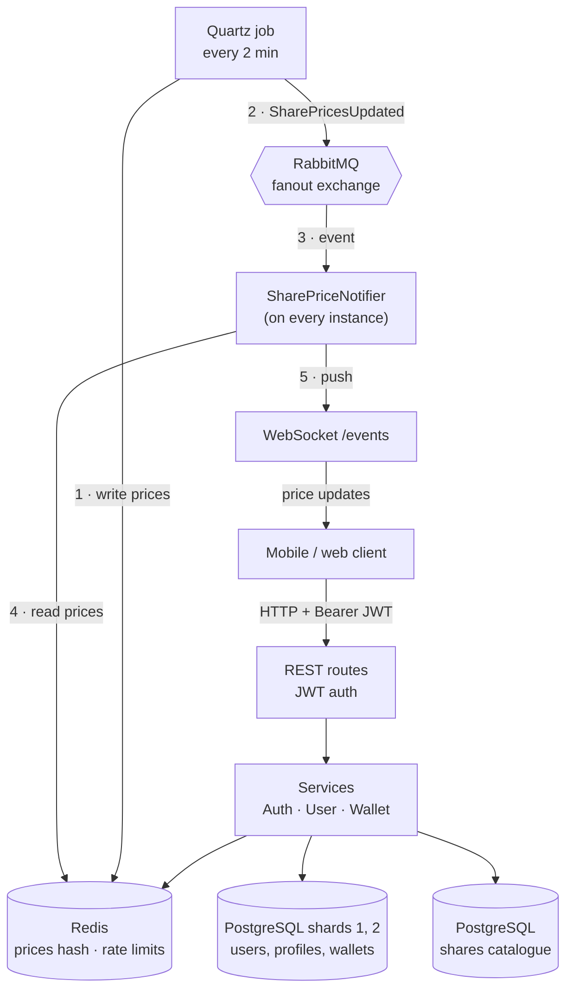
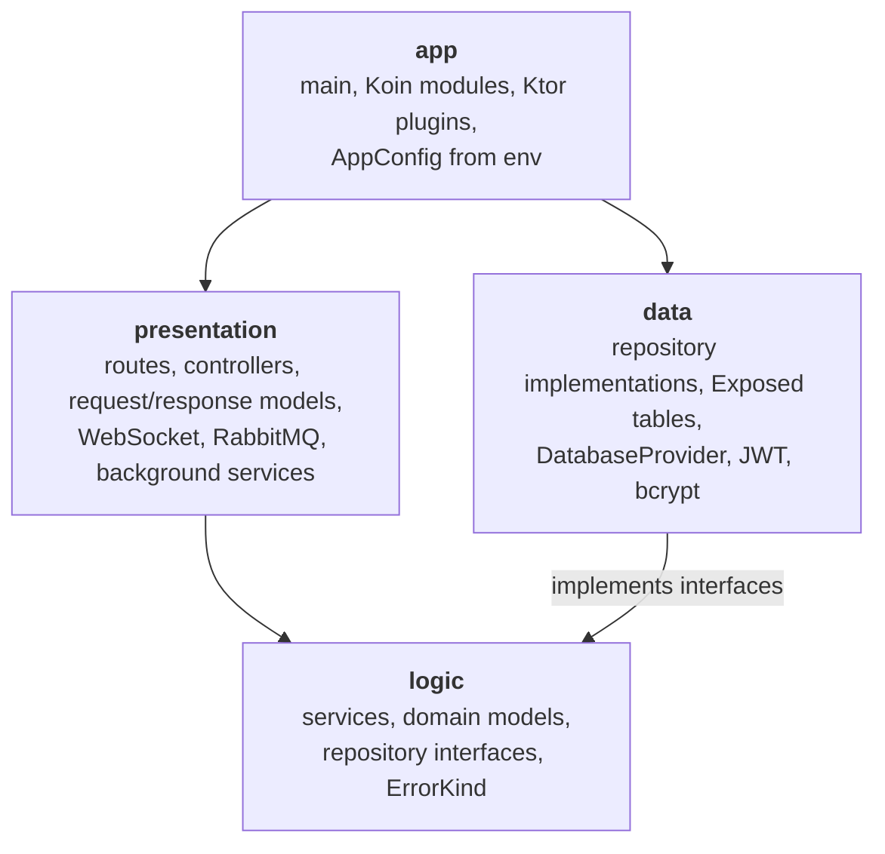
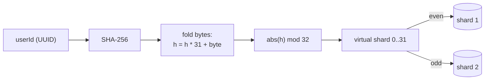
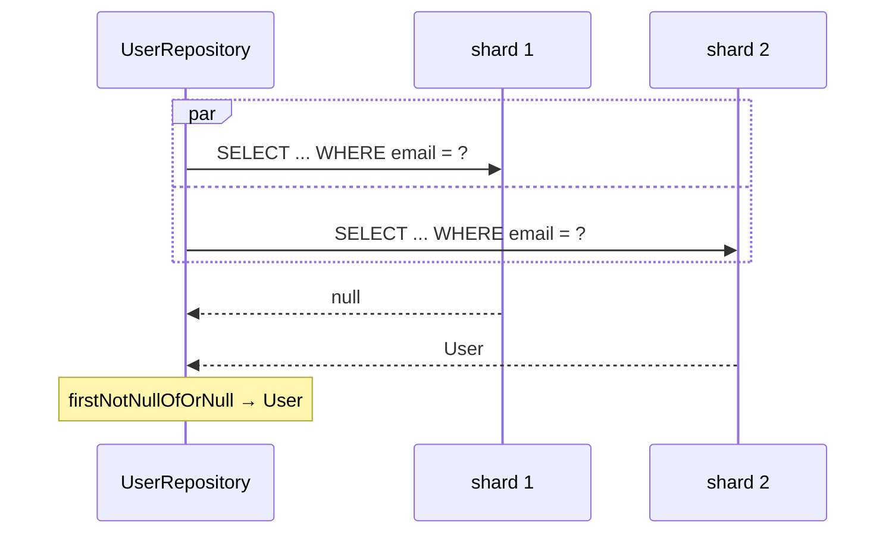
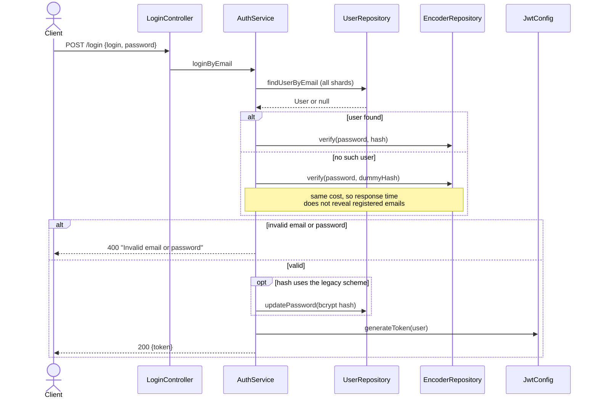
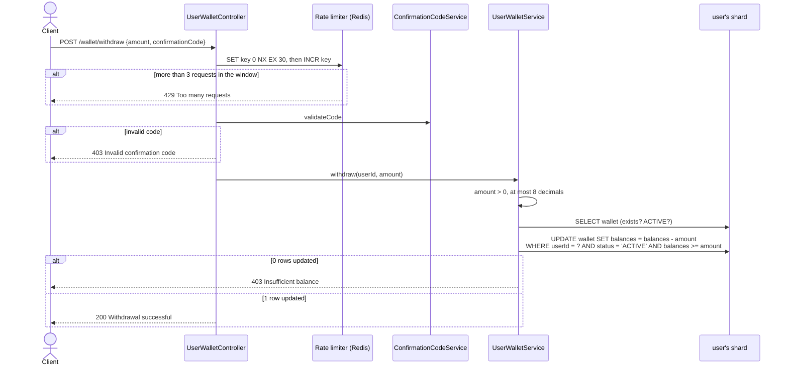
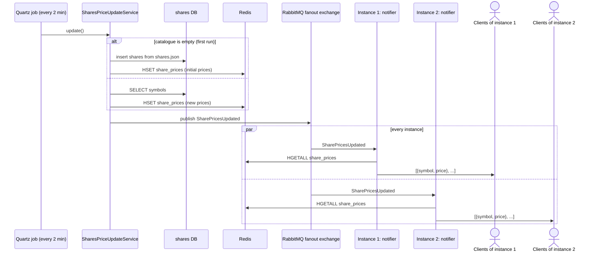
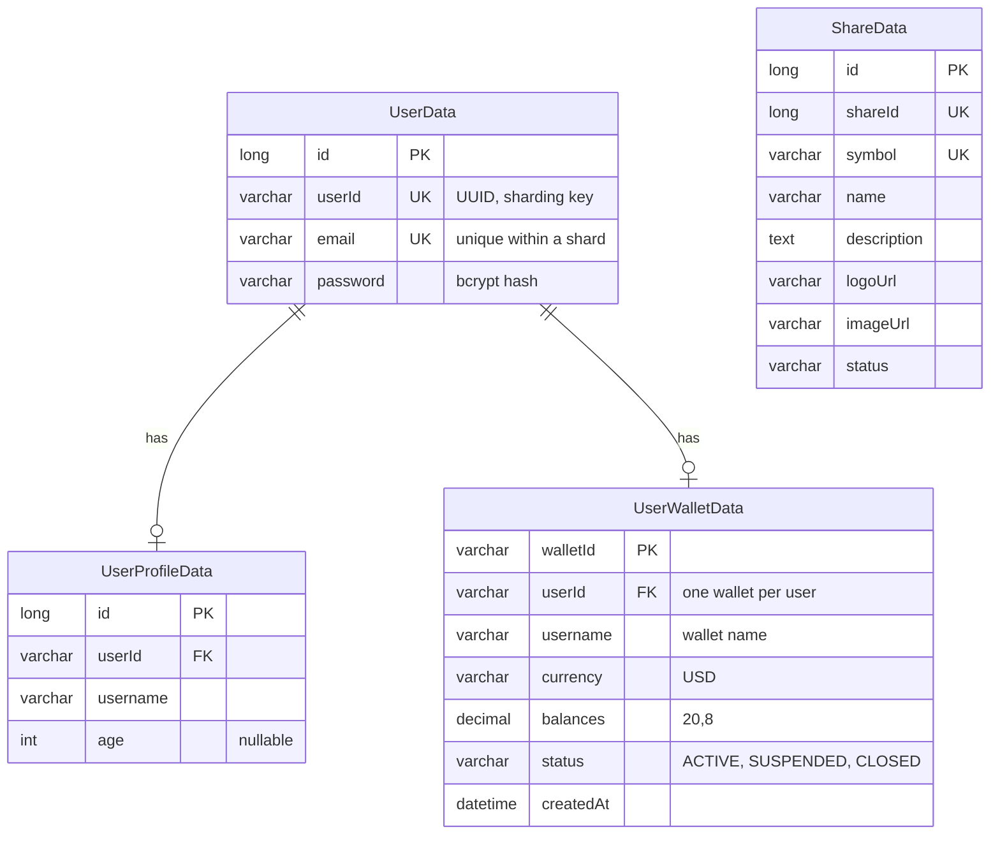

# Architecture

How the Begoml Shares backend is put together and how a request travels through it.
For setup and configuration see the [README](../README.md).

- [System overview](#system-overview)
- [Layers](#layers)
- [Sharding](#sharding)
- [Authentication](#authentication)
- [Wallet operations](#wallet-operations)
- [Share prices: from scheduler to WebSocket](#share-prices-from-scheduler-to-websocket)
- [Data model](#data-model)
- [Errors](#errors)
- [Known limitations](#known-limitations)

## System overview

One server process (Ktor on CIO, port 8080) serves REST, a WebSocket and Swagger UI.
User data lives in two PostgreSQL shards, the share catalogue in a third database.
Redis holds prices and rate-limit counters. RabbitMQ carries events between server instances.

| Component | Used for |
|---|---|
| Ktor 2.3 (CIO) | HTTP server, routing, JWT auth, WebSockets, StatusPages, Swagger UI |
| Koin | Dependency injection, wiring in `app/di/component.kt` |
| Exposed + PostgreSQL | Users, profiles, wallets (sharded) and the share catalogue |
| Redis (Jedis, pooled) | Current share prices, wallet rate limiting |
| RabbitMQ | Broadcasting events to all server instances |
| Quartz | Periodic jobs: price update (2 min), news update (12 h, not implemented yet) |
| bcrypt | Password hashing |

## Layers

The code follows a layered (Clean-style) structure. Dependencies point inward:
`logic` knows nothing about Ktor, Exposed, Redis or auth0 and talks to storage only through interfaces.

| Package | Contents |
|---|---|
| `app` | `Application.kt` (startup), `AppConfig` (environment), `di/component.kt` (Koin), `plugins/*` (auth, routing, serialization, sockets, status pages) |
| `presentation` | `features/<feature>/` with `routing.kt`, a controller and `models.kt`; `features/events` (WebSocket); `services` (RabbitMQ, scheduled updaters) |
| `logic` | `services/*` (business rules), `repositories/*` (interfaces and domain models), `exceptions`, `validation` |
| `data` | `repository/*` (implementations), `database/*` (tables, sharding, `dbQuery`), `tools/JwtConfig` |
| `core` | Quartz scheduler setup |

Database work runs through `dbQuery`, a wrapper around `newSuspendedTransaction(Dispatchers.IO)`,
so JDBC calls never block the threads that handle requests. Redis calls are wrapped in `withContext(Dispatchers.IO)` the same way.

## Sharding

User data (`UserData`, `UserProfileData`, `UserWalletData`) is split across physical databases by `userId`.
`userId` goes through a fixed hash into one of **32 virtual shards**, and each virtual shard maps to a physical database.
Virtual shards keep the hash stable: adding a physical database later only means moving whole virtual shards, not rehashing every user.

Everything keyed by `userId` goes to exactly one shard. Login only knows the email,
so `findUserByEmail` asks **all** shards in parallel and takes the one non-empty answer:

The share catalogue is not user data and lives in its own database (`DATABASE_URL_SHARES`).

## Authentication

Passwords are hashed with bcrypt (cost 12). Hashes from the old HMAC scheme are still accepted and are replaced with bcrypt on the next successful login.
A successful login or registration returns a JWT (HMAC-512, issuer `com.begoml.shares`, valid for 1 day) with a `userId` claim.
Protected routes and the WebSocket expect it in `Authorization: Bearer <token>`.

Registration validates the email and password, checks every shard for the email, creates the user on the shard chosen by a new UUID and returns a token the same way.

## Wallet operations

Each user has at most one wallet. Deposits and withdrawals are rate limited (3 per 30 seconds per user),
need a confirmation code and work only on an `ACTIVE` wallet.
The balance changes in **one SQL statement**. For a withdrawal the balance check sits in the `WHERE` clause,
so two concurrent withdrawals cannot both pass the check and overdraw the wallet.

A deposit takes the same path with `balances = balances + amount` and no balance condition.

> The confirmation code check is a stub: it accepts the fixed code `333`.

## Share prices: from scheduler to WebSocket

Prices are stored in one Redis hash, `share_prices` (symbol → price), and are read with `HGETALL` or `HGET`.
Every 2 minutes a Quartz job refreshes them and announces it over RabbitMQ.
The event goes to a **fanout exchange**, and every server instance has its own queue bound to it,
so each instance pushes the new prices to its own WebSocket clients.

> Prices are random numbers for now (`loadPrices` in `SharesRepositoryImpl`); a real market data source is a TODO.
> With several instances, every instance runs its own Quartz job, so prices are refreshed once per instance.

A client subscribes by opening `ws://<host>:8080/events` with the JWT header. One user may hold several connections (several devices), and each gets every update.

## Data model

`UserData`, `UserProfileData` and `UserWalletData` exist on every user shard; `ShareData` only in the shares database.
Tables are created at startup with `SchemaUtils.create`; there are no migrations yet.

| Redis key | Type | Content |
|---|---|---|
| `share_prices` | hash | symbol → current price |
| `user_wallet_rate_limit:<userId>` | string, TTL 30 s | number of wallet operations in the current window |

## Errors

Services throw `CommonException` with a transport-independent `ErrorKind`; `StatusPages` turns it into an HTTP status.

| Source | HTTP status |
|---|---|
| `ErrorKind.BAD_REQUEST`, `IllegalArgumentException` (`require`), malformed JSON | 400 |
| Missing or invalid JWT | 401 |
| `ErrorKind.FORBIDDEN` | 403 |
| `ErrorKind.NOT_FOUND` | 404 |
| `ErrorKind.CONFLICT` | 409 |
| `RateLimitException` | 429 |
| Anything else (logged) | 500 |

## Known limitations

- Email uniqueness is enforced per shard only; two registrations with the same email racing on different shards can both succeed.
- The confirmation code is a stub and news updates are not implemented.
- Share prices are random.
- No schema migrations: changes to existing tables (for example the wallet primary key) are not applied to databases created earlier.
- The watch list routes (`/watchList/add`, `/watchList/remove`) are empty.
- `documentation.yaml` (Swagger) describes only the auth and user endpoints.
